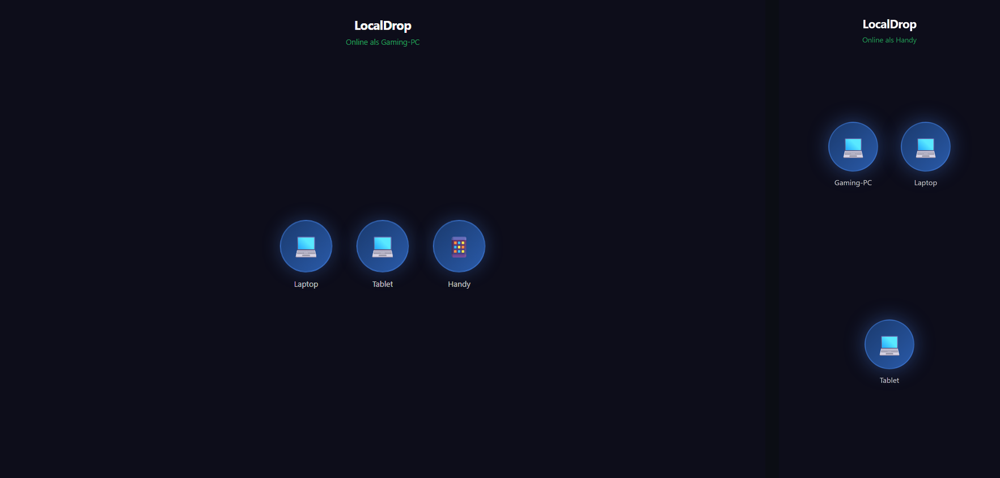

# LocalDrop

**AirDrop for your home network.** Open a web page on your phone, tap a device bubble, pick a file, and it lands on your PC. Works between phones, tablets and Windows PCs, without any cloud.



## How it works

```
[Windows PC – tray app] ⇄ WebSocket ⇄ [LocalDrop server (Docker)] ⇄ WebSocket ⇄ [Phone – browser]
```

- A small **FastAPI + WebSocket relay server** runs in Docker (e.g. on a NAS like TrueNAS SCALE, a Raspberry Pi or any home server).
- Every device that opens the web UI shows up as a **bubble** on all the others.
- Tap a bubble (or drag & drop a file onto it) to send. The receiver gets a notification and a download button.
- The optional **Windows tray app** stays connected in the background and saves incoming files to `Desktop\Transfers` automatically, with a toast notification.
- `/qr` shows a QR code of the server URL, so phones can join with a single scan.
- The server only relays: a file is deleted as soon as it has been downloaded, and leftovers older than 24 hours are cleaned up on startup.

## Quick start

### 1. Server (Docker)

```bash
git clone https://github.com/GamingPaule/localdrop.git
cd localdrop
# Adjust the volume path in docker-compose.yml to a folder on your server
docker compose up -d
```

Then open `http://<server-ip>:8765` on any device in your network.

To run it without Docker:

```bash
cd server
pip install -r requirements.txt
LOCALDROP_DATA=./transfers uvicorn main:app --host 0.0.0.0 --port 8765
```

### 2. Windows tray app (optional)

```powershell
cd tray
pip install -r requirements.txt
python main.py
```

On the first start a `config.json` opens in Notepad (`%APPDATA%\LocalDrop\config.json`). Set `server_url` to `http://<server-ip>:8765` and start the app again.

To build a standalone `LocalDrop.exe`:

```powershell
pyinstaller build.spec
```

## Tests

```bash
cd server
pip install -r requirements.txt
pytest tests/ -v
```

## Security note

LocalDrop is meant for a **trusted home network**. There is no login: everyone who can reach the server can see the connected devices and send files. Don't expose port 8765 to the internet. If you need remote access, put it behind a VPN (WireGuard, Tailscale).

## Tech stack

- **Server:** Python 3.11 · FastAPI · WebSockets · aiofiles · qrcode
- **Tray:** pystray · websockets · httpx · plyer · PyInstaller
- **UI:** vanilla JS · CSS · PWA (no build step)

## License

[MIT](LICENSE) © 2026 Paul Hohmann

---

### 🇩🇪 Kurz auf Deutsch

LocalDrop funktioniert wie AirDrop fürs Heimnetz. Ein kleiner Server läuft im Docker-Container, zum Beispiel auf dem NAS. Jedes Gerät, das die Webseite öffnet, erscheint bei den anderen als Bubble: antippen, Datei wählen, fertig. Die Windows-Tray-App empfängt im Hintergrund und speichert alles in `Desktop\Transfers`. Nur im eigenen Netz betreiben, denn es gibt keinen Login.
